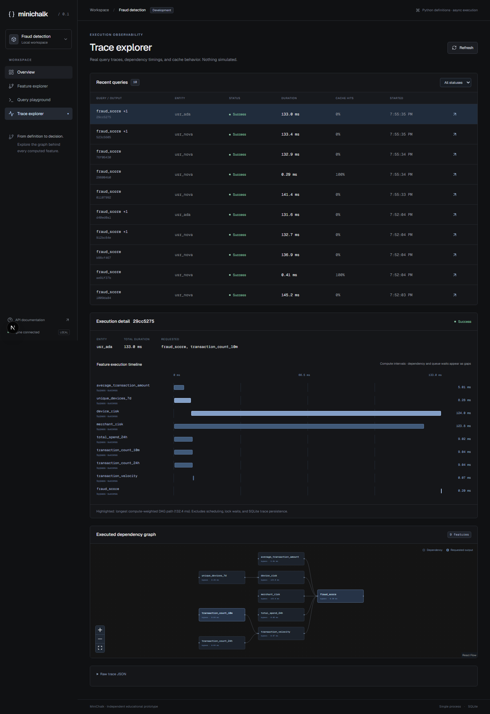
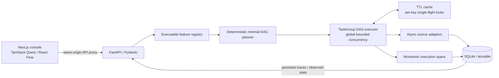

# MiniChalk

MiniChalk is an independent educational feature computation engine: define async Python features, request outputs, and inspect the dependency graph and actual execution timings. Its fraud detection demo connects SQLite data to a FastAPI engine and a compact Next.js developer console. It is inspired by public feature-platform concepts and is not affiliated with Chalk.



## Quick start

Requires Python 3.12+, [uv](https://docs.astral.sh/uv/getting-started/installation/), Node 22+, and npm. Install dependencies with Node 22+ so npm includes the required native packages. The frontend also pins a project-local Node 22 runtime for scripts.

From this directory:

```sh
make install
make dev
```

Open **http://localhost:3000**. OpenAPI/Swagger is at **http://localhost:8000/docs**. Ctrl-C stops both services. The first backend startup creates and seeds `backend/data/minichalk.sqlite3`; the console initially shows honest empty states.

Or use two terminals:

```sh
cd backend
uv sync --frozen
uv run uvicorn app.main:app --reload --port 8000
```

```sh
cd frontend
npm ci
npm run dev
```

For a production build of the local console: `cd frontend && npm run build && npm start`. Keep the backend running. `BACKEND_URL` configures the Next.js API proxy (default `http://127.0.0.1:8000`). `MINICHALK_DB` configures the backend SQLite path. This demo is intended for local use and has no authentication.

## Architecture



`backend/app/engine/` contains graph validation, cache, executor, and trace models. `features/fraud.py` defines the nine real executable features. `sources/` owns data access; API handlers delegate computation to the engine. `frontend/` provides Overview, Feature Explorer, Query Playground, and Trace Explorer. API types are generated from the actual OpenAPI schema, not maintained separately.

### Registry and planning

Decorators register async functions with explicit dependencies, return type validation, TTLs, descriptions, and an explicit definition version. Registration rejects duplicates and sync functions. Startup validates all definitions; each query resolves only the transitive closure of its requested outputs. Sorted traversal produces stable node ordering, layers, and directed edges; missing definitions and cycles produce useful errors. A shared dependency appears once, including in diamond graphs and multi-output queries.

```python
from app.engine.registry import Registry

registry = Registry()

@registry.feature("user.base", ttl_seconds=30, version="1")
async def base(ctx) -> int:
    return 4

@registry.feature("user.double", dependencies=["user.base"], version="1")
async def double(ctx, deps) -> int:
    return deps["user.base"] * 2
```

Add demo definitions to `build_registry()` to expose them through the API. Functions execute as Python; the frontend cannot submit code. Return annotations are validated strictly with Pydantic and converted to JSON before caching. Query parameters must be a JSON object. Demo formulas deliberately do not change with parameters, but keys still distinguish parameters.

### Async scheduling and failures

One TaskGroup task is created per plan node. It awaits its prerequisites, then a per-key cache lock, then the process-wide compute semaphore. Dependency waits consume no compute permits, preventing a low-concurrency dependency deadlock. Ready branches run as soon as their dependencies complete; execution is not gated by topological layers.

A failing task cancels siblings, and TaskGroup drains all tasks before the query completes. No dependent function executes after a prerequisite fails, and no partial query result is returned. Completed, successful feature values may remain cached if another branch later fails; failures and incomplete feature computations are never cached. A timeout returns a trace with `status: timeout`; caller cancellation is re-raised after trace persistence. Query execution failures are represented in the returned trace (HTTP 200), while invalid requests use 422 and unknown entities/resources use 404.

The deadline covers planning-independent execution and cache waits; trace persistence happens afterward and is excluded from the execution duration. asyncio cancellation is cooperative: uncooperative CPU-bound user code cannot be forcibly interrupted. SQLite operations use aiosqlite's worker thread, never blocking calls on the event loop.

### Caching and freshness

The bounded, process-local cache has 4,096 entries, TTL expiration, LRU eviction, isolated copied values, and entity/feature invalidation. Keys contain feature identity, entity identity, canonical JSON parameters, and a hash of the feature's version plus all transitive dependency versions. **Increment the explicit version when changing a definition.** Bypass neither reads nor populates the cache.

Per-key locks coalesce concurrent successful cache misses. Waiters reuse a completed result, or compute after the producer fails/cancels; there is no detached producer task. TTL-zero features and cache-bypassed requests deliberately do not coalesce. Locks are reference-counted and removed when no requests use them.

Invalidating a feature invalidates it and every transitive dependent. Entity invalidation covers that entity's complete cache. A generation fence prevents computations started before invalidation from writing late results back into the cache. The fence is deliberately conservative and global: unrelated in-flight writes can also be discarded.

TTL caching is **not** a source snapshot or freshness guarantee. A derived value may remain cached after a dependency expires or changes; reading new dependencies does not automatically invalidate that value. Source mutations must call coherent entity/feature invalidation; the demo has no data mutation API. The executor conservatively visits the complete static plan even when a downstream output is cached, keeping the displayed graph and executed plan aligned. It does not prune dependency tasks based on a downstream cache hit.

### Data and risk formula

Three seeded users have normal, elevated, and suspicious histories across users, transactions, merchants, devices, and device_sessions. Randomness uses seed 42. The initial UTC reference time is persisted with the dataset; windowed features use that time rather than the moving wall clock. This prevents the ten-minute demo window silently emptying during a presentation. Use a new database path to seed a fresh dataset.

`fraud_score` is a transparent, deterministic **demonstration score**, not a trained model:

```text
velocity = min(20, count_10m / max(1, count_24h / 144))
device_risk = min(1, max_observed_device_risk + max(0, unique_devices - 2) * .04)
score = 100 * (
    .30 * min(1, velocity / 10)
  + .25 * device_risk
  + .20 * max_recent_merchant_risk
  + .15 * min(1, spend_24h / 20000)
  + .10 * min(1, average_transaction_amount / 1000)
)
```

Device and merchant adapters each include an explicitly artificial 120ms async I/O delay, with no remote call. Their independent intervals visibly overlap in a cold-cache trace.

### Tracing and statistics

Every executed query records an ID, requested outputs, entity, parameters, UTC timestamps, monotonic duration, graph, feature statuses, cache decisions, compute start/end offsets, errors, and results. SQLite retains the most recent 1,000 traces across restarts. Cache contents reset on restart. Overview statistics use only those persisted traces; cache bypass spans are excluded from the cache lookup denominator. Null statistics display dashes before any observations exist.

Timeline bars show active computation, not dependency/lock/permit waits. Cache hits have zero compute duration and appear as narrow markers. The highlighted path is the longest DAG path weighted by observed compute durations, excluding waiting and persistence. It is **not** a general wall-clock critical-path analysis under resource contention. Durations include cooperative I/O within the function. Trace JSON contains per-feature errors and the full plan.

## API

| Method | Endpoint | Behavior |
| --- | --- | --- |
| GET | `/api/health` | SQLite connectivity, demo reference time, artificial delay |
| GET | `/api/entities` | Seeded entities |
| GET | `/api/features` | Registry metadata |
| GET | `/api/features/{name}` | Definition metadata |
| GET | `/api/features/{name}/graph` | Actual transitive plan |
| POST | `/api/plan` | Multi-output plan without execution |
| POST | `/api/query` | Execute and persist a trace |
| GET | `/api/traces?limit=100` | Recent traces (1–1,000) |
| GET | `/api/traces/{id}` | Complete trace |
| GET | `/api/stats` | Observed metrics |
| POST | `/api/cache/invalidate` | Invalidate feature + dependents and/or entity |

```sh
curl -s http://localhost:8000/api/query \
  -H 'Content-Type: application/json' \
  -d '{"entity_id":"usr_nova","features":["user.fraud_score"],"bypass_cache":false,"timeout_seconds":5}'
```

## Verification and benchmarks

```sh
make test
make types        # export OpenAPI and regenerate frontend schema types
make check        # Python lint, TypeScript, ESLint, production build
make benchmark    # 20 observations per mode per workload
```

The engine suite (16 passing tests) covers registry errors, deterministic graphs, diamond/shared/multiple/disconnected outputs, a two-event concurrency rendezvous, bounded execution, dependency ordering, failures, strict output validation, timeout/cancellation cleanup, TTLs with a fake clock, entity/parameter key isolation, single-flight coalescing, value isolation, capacity, invalidation fencing, and a persisted end-to-end fraud query.

`benchmarks/run.py` compares the same DAG with a compute semaphore of one (sequential) and eight (concurrent), with cold and warm caches. It reports median, nearest-rank P95, executed features, observed hit rate, and speedup. Artificial 120ms I/O and local SQLite without artificial delays are separate workloads; SQLite itself uses one worker connection and can serialize local reads. Trace persistence and HTTP/frontend overhead are excluded. Warm-up is excluded from warm measurements. See [recorded results](benchmarks/results.json); rerun on your machine. These are educational single-process measurements, not production latency claims.

## Engineering tradeoffs and limits

- **DAG rather than handwritten orchestration:** explicit dependencies enable validation, deterministic planning, shared-work elimination, and an inspectable execution graph. The current graph is small and static; very deep graphs need iterative planning and task-count limits.
- **asyncio rather than threads for feature execution:** I/O branches overlap with structured lifetime management. CPU-bound work would require process workers or compiled/vectorized compute; untrusted feature code must not run in this process.
- **Exactly once within a query:** a node has one task, and all consumers await that task. Cross-query coalescing is local and only for successful cached computations; it is not a distributed exactly-once guarantee.
- **Bounded compute, bounded memory cache:** permits apply across concurrent queries. There is no global query admission control; high request volume can still create many waiting tasks. Cache values are mutable JSON copied at the boundary.
- **SQLite and one process:** source reads are off the event loop, but one connection serializes database work. Trace writes have an async lock. There is no multi-replica shared cache, distributed scheduling, durable work queue, or snapshot transaction across multiple feature reads.
- **Historical correctness:** real point-in-time features need event and ingestion timestamps, consistent as-of reads, late-arrival policies, historical definitions, and leakage-free joins. A frozen demo clock alone does not supply those guarantees.
- **Distributed execution:** needs partitioned ownership, shared cache/version namespaces, distributed coalescing/leases, retries and idempotency, admission/backpressure, cancellation protocols, and trace context propagation. Local asyncio locks cannot coordinate multiple replicas.
- **Observability cost:** listing traces returns full JSON and computing stats scans up to 1,000 records. Suitable for a demo; larger systems need indexed summaries, pagination, retention policy, and telemetry backends.

## Relationship to Chalk

This project demonstrates public concepts such as executable feature definitions, dependency resolution, online computation, caching, and tracing. [Chalk's public site](https://chalk.ai) describes a substantially broader production platform. MiniChalk does not implement Chalk's infrastructure, compiler, distributed runtime, streaming ingestion, online/offline stores, historical joins, production serving guarantees, or managed integrations. No proprietary branding, assets, or affiliation are implied.

The console takes cues from the compact navigation and technical presentation of [Linear](https://linear.app) and [Vercel](https://vercel.com), without copying their branding. It uses shadcn-style Button/Switch components backed by Radix, Tailwind CSS, Lucide, TanStack Query, and React Flow with Dagre layout.

## 60-second demo

1. **0–10s:** Open Overview. Explain that the counters are observed executions, then open Feature Explorer and select `user.fraud_score`.
2. **10–20s:** Follow the graph from transaction counts through velocity into the final score. Explain how shared dependencies become one task.
3. **20–35s:** Open Playground. Select Nova, invalidate the entity cache, and execute `user.fraud_score`. Inspect the actual score and open Execution trace.
4. **35–45s:** Point to overlapping device/merchant intervals and their labeled artificial I/O. Explain that dependencies wait without holding compute permits.
5. **45–55s:** Execute again with bypass disabled. Show cache hits and the measured duration. Switch to Ada and show a lower computed score.
6. **55–60s:** Open Trace Explorer. Explain persisted traces, TTL freshness limits, and the distinction between this single-process prototype and a distributed feature platform.

## Five decisions to understand before an engineering conversation

1. **A deterministic plan is also the observable graph.** Requested outputs determine the transitive closure; one shared task prevents duplicate work in diamond graphs.
2. **Wait before taking scarce resources.** Dependency waits and single-flight waits happen before semaphore acquisition, avoiding dependency deadlocks and wasted compute capacity.
3. **Caching is a correctness policy.** Transitive definition versions, downstream invalidation, and generation fences solve different invalidation problems; none automatically solves source freshness.
4. **Structured concurrency defines failure semantics.** TaskGroup cancellation drains siblings, failed dependencies cannot produce computed dependents, and only complete queries expose results.
5. **Compute critical paths differ from elapsed latency.** Cache hits, queueing, source serialization, and persistence all affect latency; the UI labels precisely what its measured intervals include.

The console uses Next.js’s supported Webpack bundler explicitly: the installed Tailwind/PostCSS ESM dependency currently fails in the Turbopack evaluator. An override updates the ESLint toolchain’s minimatch dependency to its fixed release; npm audit reports zero vulnerabilities in the recorded install.

Optional browser smoke check: with Chrome remote debugging on port 9222 and both services running, `cd frontend && npm run smoke`. It checks real cold/warm/bypass and multi-output queries, entity comparison, feature search, traces, mobile width, and browser exceptions, and writes screenshots to `docs/screenshots/`.
